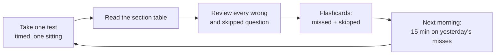
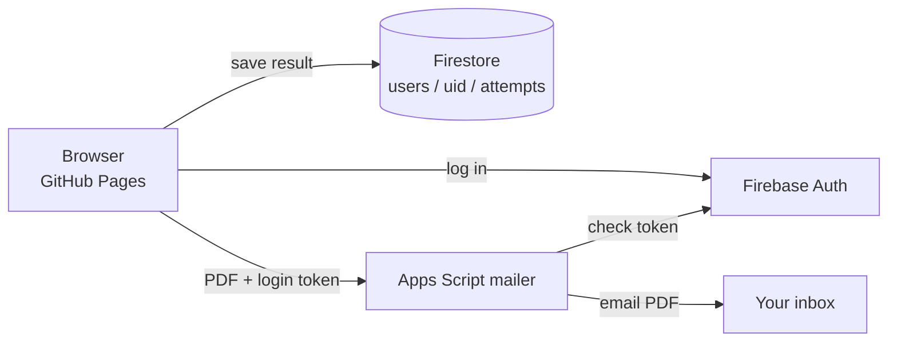

# 📝 SPSC CCE-2026 Mock Tests

**21 full-length mock tests. 200 MCQs each. 4,200 different questions. SPSC marking. Your own login, your own scores, and a PDF report in your inbox.**

[](https://mursalfk.github.io/spsc-cce-mock-tests/)


> Built for the **SPSC CCE-2026 Screening Test** (Saturday, 28 November 2026). One test a day, three weeks, no excuses.

**👉 Live: <https://mursalfk.github.io/spsc-cce-mock-tests/>**

Browse the tests freely. Log in to attempt them. Open it on your phone, add it to your home screen, and practise anywhere.

---

## ✨ What you get

- ⏱️ **Timed exam mode**: 200-minute countdown, question palette, mark for review, auto-submit at zero.
- 📖 **Study mode**: no timer, right answer and explanation straight after every pick.
- 🃏 **Flashcards**: question on the front, answer on the back. After an exam, one tap builds a deck from your **missed and skipped** questions.
- 📊 **Section-wise report**: net score, pass or fail line, a table per section, and a **guess audit** that shows what wild guessing cost you.
- 🔁 **No repeats**: every test has its own 200 questions, and no fact is asked twice across all 21 tests, not even re-worded.
- 👤 **Your own account**: log in with email or Google. Every user has separate tests in progress, scores and history.
- 📧 **PDF report by email**: after every timed exam you get a detailed PDF (section table, where to focus, guess audit, every wrong and skipped question with the right answer). Download or resend it from the result page.
- 🌐 **Open to browse**: anyone can see the test list. Login is needed only to attempt a test.

## 🧮 Marking (same as the SPSC advertisement)

| Rule | Value |
|---|---|
| Questions | 200 MCQs, 1 mark each |
| Wrong answer | −0.25 |
| Unanswered | 0 |
| Pass mark | **66 net** (33% of 200) |
| Time | 200 minutes |
| Net score | `correct − 0.25 × wrong` |

A blind guess among four options is worth about **+0.06** on average. Guess only after you can rule out at least one option.

## 🗂️ Paper blueprint (identical in every test)

| Section | Questions |
|---|---:|
| English | 40 |
| Everyday Science | 32 |
| Pakistan Affairs and Sindh | 26 |
| Islamic Studies | 26 |
| Current Affairs | 24 |
| World Geography and Celestial Bodies | 14 |
| Mathematics | 14 |
| Reasoning | 12 |
| Digital Literacy and IT | 12 |
| **Total** | **200** |

> The section split is an estimate from past papers and third-party reports. It is **not** an official SPSC blueprint.

## 🔄 The 21-day loop



Aim for a **rising** net score, not one lucky day. Target **90+ net** before 28 November to leave a real margin over 66.

## 🚀 Use it

**Online:** <https://mursalfk.github.io/spsc-cce-mock-tests/>

1. Open the site. Pick a test.
2. Create an account (or use Google). Verify your email once.
3. Take the timed exam. The PDF report lands in your inbox.

**Running your own copy:** follow [`instructions.md`](instructions.md) (Firebase, the email sender, GitHub Pages). Free, no credit card.

**Locally:** login needs a web address, not a double-clicked file.

```bash
git clone https://github.com/mursalfk/spsc-cce-mock-tests.git
cd spsc-cce-mock-tests
python3 -m http.server 8000   # then open http://localhost:8000
```

## 🔧 How it works



- **Static site.** Plain HTML, CSS and vanilla JavaScript. No build step, no framework.
- **Firebase Auth** handles accounts and email verification. **Firestore** stores each user's results; the [rules](firestore.rules) let a user touch only their own.
- **PDF** is built in the browser (jsPDF). A small **Google Apps Script** ([`backend/Code.gs`](backend/Code.gs)) emails it, only to the address on the verified login, with per-user daily limits.
- Free-tier only: Firebase Spark plan and a Gmail account. No Cloud Functions, no billing.

## 🧱 Structure

```
.
├── index.html                 # public test list + your progress
├── SPSC_CCE_Mock_01.html      # each test is one file (questions embedded)
├── ...
├── SPSC_CCE_Mock_21.html
├── assets/
│   ├── app.js                 # login, per-user records, report + email
│   ├── report.js              # PDF report builder
│   ├── auth.css
│   ├── firebase-config.js     # your Firebase + mailer settings
│   └── vendor/                # Firebase SDK, jsPDF (no CDN)
├── backend/Code.gs            # Apps Script email sender
├── firestore.rules            # database rules
├── instructions.md            # setup guide
├── STUDY_GUIDE.md             # how to use the 21 tests
└── README.md
```

## 💾 Your progress

- **Finished timed exams** are saved to your account: score, right, wrong, skipped, section split, time. They follow you across devices.
- **Answers in progress** are kept in the browser under your account. A second user on the same device sees none of them.
- **Study mode and flashcards** are not scored or emailed.

## ⚠️ Read this before you trust it blindly

- **Unofficial.** Not affiliated with, endorsed by or connected to the Sindh Public Service Commission.
- **Original questions.** Written for this project. None are copied from past papers or books.
- **Four options assumed** (A to D). The exact 2026 paper layout is not confirmed.
- **"None of these"** appears in about 10% of questions from Test 4 onward. Tests 1 to 3 have none, so the format starts gentle.
- **Current Affairs is dated** to about **7 November 2026**. Re-check office-holders, results and anything with "currently" in the stem in the last week before the exam.
- **With 4,200 questions, a few will be wrong or arguable.** Please report them.
- **The login is a front-end gate.** The questions ship inside the page files, so a technical visitor can read them in page source. The gate controls who gets scores and emailed reports, not who can possibly see a question.
- **Email limits.** Reports go out through a Gmail account: about 100 a day for all users together. The Download button always works.

## 🐞 Found a mistake?

Open an [issue](https://github.com/mursalfk/spsc-cce-mock-tests/issues) with the **test number** and **question number**, plus what you think is right. A source link helps.

## 👤 Author

**Mursal Furqan Kumbhar**, from Pakistan.
Portfolio: [mursalfk.vercel.app](https://mursalfk.vercel.app) · GitHub: [mursalfk](https://github.com/mursalfk)

## 📄 Licence

[MIT](LICENSE). Free to use for your own exam prep. Third-party libraries are listed in [`assets/vendor/THIRD_PARTY_NOTICES.md`](assets/vendor/THIRD_PARTY_NOTICES.md).

---

<p align="center"><b>Good luck on 28 November... and may your net score be well above 66. 🌟</b></p>
